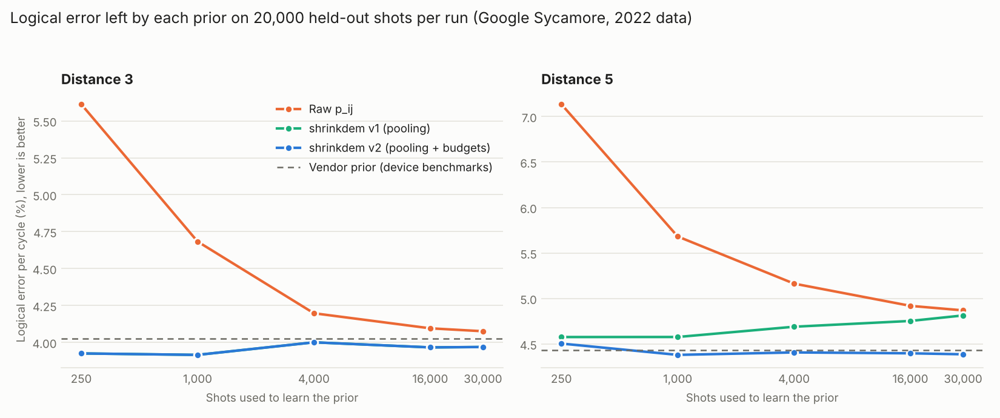

# shrinkdem

Learn the noise map of a quantum error-correcting decoder from a few hundred shots of
its own syndrome data, with no device model.

## The problem

A surface-code decoder needs a prior: how likely each error mechanism is on this chip,
today. Teams get it from device benchmarks (slow, needs a noise model) or from
correlations in the syndrome data (the p_ij method). The p_ij method is simple and
needs no model, but it is noisy: with few shots it produces a prior that decodes worse
than knowing nothing, and on Google's distance-5 data it never catches up with the
benchmark-based prior even with 30,000 shots.

## What this does

Two additions on top of the classic p_ij estimator:

1. **Partial pooling.** The same edge repeats every round, and the same kind of edge
   repeats across the patch. Each estimate is shrunk toward its group mean by an amount
   set by its own sampling noise (empirical Bayes, two levels).
2. **Detector budgets.** Events that fire three or more detectors inflate every pair
   they touch, which starves the boundary edges. Detectors with no boundary edge give a
   hard budget, so the pair edges are rescaled until those budgets close.

It also ships a small monitor that finds error bursts from syndromes alone.

Only the list of possible edges is taken from a reference model. No probabilities, no
logical labels, no training.

## Results on real hardware

Data: Google's 2022 Sycamore surface-code runs (Zenodo 6804040). 130 runs, prior
learned from the first N shots of each run, scored on its last 20,000 shots (2.6 million
held-out shots). Decoder: PyMatching in every row. Error per cycle relative to Google's
benchmark-based prior:

| Prior | Shots | Distance 3 | Distance 5 |
|---|---|---|---|
| Uniform | 0 | +10.2% | +30.7% |
| Raw p_ij | 1,000 | +16.4% | +28.1% |
| Raw p_ij | 30,000 | +1.3% | +9.8% |
| **shrinkdem** | 250 | -2.5% (but 2.8% more errors in total) | +1.6% |
| **shrinkdem** | 1,000 | -2.7% | -1.2% |
| **shrinkdem** | 30,000 | -1.4% | -1.1% |
| Google's own p_ij model | 25,000 | -2.9% | -0.2% |



What holds and what does not:

- With 1,000 shots it matches the benchmark-based prior (same number of logical errors
  at distance 3, 0.4% more at distance 5). Raw p_ij needs about 16,000 at distance 3 and
  never gets there at distance 5.
- It does not beat the vendor prior by much: about 1% at best. Google's own p_ij model
  is slightly better at distance 3 with all the data.
- The prior is a second-order effect. Swapping the decoder (correlated matching, belief
  matching, tensor network) cuts the error by 13% to 33% on the same shots.
- Pooling alone (v1) gets worse with more data at distance 5. The budget step fixes it.
  On simulated data the budget step slightly hurts the fit, so it is a heuristic.
- Refreshing the prior with a trailing window did not clearly help inside a run. Using
  all past shots did: 0.6% to 0.8% fewer errors than the vendor prior.
- The monitor flags 520 of 500,000 repetition-code shots. They hold 31 of the 35 logical
  errors of that run, including the high-energy event Google reported near shot 57,775.

Full tables: `results/summary.md`.

## Run it

```bash
pip install -r requirements.txt
python examples/quickstart.py        # real Sycamore run bundled in sample_data/, no download
python -m pytest -q tests            # 4 checks on simulated data, where the true error model is known

python scripts/download_data.py      # 315 MB from Zenodo into data/raw
python scripts/run_benchmark.py      # about 20 minutes on one core (add --distance 5 for a 7-minute run)
python scripts/run_drift.py --distance 5 --min-rounds 5 --out results/drift_d5.csv
python scripts/run_drift.py --distance 3 --min-rounds 21 --out results/drift_d3.csv
python scripts/run_monitor.py
python scripts/make_report.py        # writes results/summary.md and the figure
```

Every result in this README comes from real hardware data. Simulation is used only in the
tests, because that is the one place where the true answer is known and can be checked.

## Use it

```python
import shrinkdem as sd

exp = sd.load_experiment("data/raw/surface_code_bZ_d5_r25_center_5_5")
topology = sd.topology_from_dem(exp.vendor_dem(), exp.coords)   # structure only
prior = sd.shrunk_pij(topology, exp.detections[:1000])           # syndromes only
predictions = sd.decode(topology, prior, exp.detections[30000:])
```

## Layout

- `shrinkdem/estimate.py` raw p_ij, pooling, budgets
- `shrinkdem/graph.py` edge list and pooling groups
- `shrinkdem/monitor.py` drift score and burst finder
- `shrinkdem/io.py` loader for the Google dataset
- `scripts/` benchmark, drift replay, monitor, report
- `sample_data/` one real run from the Google dataset (CC BY 4.0), used by the quickstart
- `results/` CSVs, summary and figure from the full run

## Limits

One chip, one dataset from 2022, distances 3 and 5 only, one decoder. Not tested on
distance 7 or on other hardware. Hyperedges are handled by a budget heuristic, not
estimated. The burst monitor works on a whole run, not yet shot by shot in real time.

## References

- Spitz et al., Adaptive weight estimator for quantum error correction (2018), arXiv:1712.02360
- Google Quantum AI, Suppressing quantum errors by scaling a surface code logical qubit, Nature (2023), data at Zenodo 6804040
- Sivak et al., Optimization of decoder priors for accurate quantum error correction (2024), arXiv:2406.02700
- Takou et al., Logical error estimation from syndrome data of surface-code experiments (2026), arXiv:2606.11496
- Arms et al., Estimating Detector Error Models on Google's Willow (2026), arXiv:2512.10814
